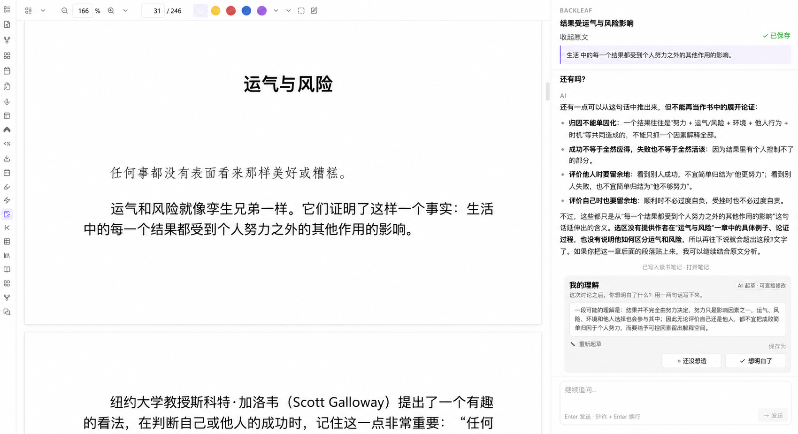
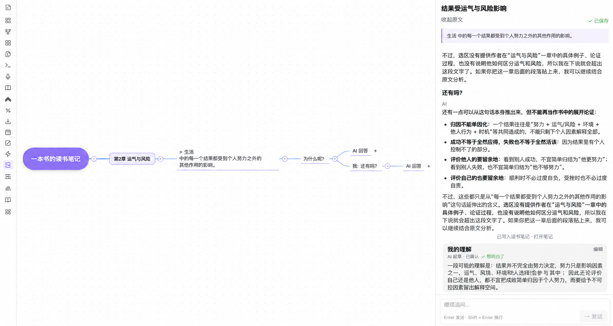

<div align="center">

# Backleaf 叶间

**밑줄을 PDF 안에만 남겨 두지 마세요.**

원문을 선택하고 AI와 질문을 발전시킨 뒤, 내 이해를 원문 링크가 포함된 Markdown 독서 노트로 남길 수 있습니다. 모든 과정은 Obsidian 안에서 이어집니다.

[English](README.md) · [简体中文](README.zh-CN.md) · [日本語](README.ja.md) · **한국어**

[](https://github.com/zefei124/backleaf/releases/latest)

[](LICENSE)

[**Obsidian에 설치**](obsidian://show-plugin?id=backleaf) · [작동 방식](#한-구절에서-생각의-흐름으로) · [개인정보 보호](docs/privacy.md) · [변경 기록](CHANGELOG.md)

</div>

---

밑줄은 쉽게 쌓이지만, 그 순간 떠오른 생각은 쉽게 사라집니다. Backleaf는 원문, 질문, 이어진 대화, 그리고 남기기로 한 이해를 하나의 독서 흐름으로 연결합니다.



## 한 구절에서 생각의 흐름으로

1. **멈춰 서게 한 문장을 선택합니다.** Obsidian PDF에서 원문을 강조합니다.
2. **원문에서 질문을 시작합니다.** 선택문, 책, 장, 페이지와 원문 링크가 대화에 함께 들어갑니다.
3. **남길 만한 이해를 결정합니다.** 생각이 선명해질 때까지 질문하고, 나의 이해를 직접 쓰거나 고칩니다.
4. **나중에 다시 생각으로 돌아갑니다.** 대화는 일반 Markdown으로 저장되며 기록이나 생각 트리에서 다시 볼 수 있습니다.

<!-- 영상이 준비되면 여기에 추가하세요:
[](VIDEO_URL)
-->

## PDF 옆에 놓인 AI 채팅 그 이상

- **맥락이 함께 남습니다.** 원문, 페이지, 장, 책과 출처로 돌아가는 링크를 대화와 함께 보존합니다.
- **대화가 오래 남는 노트가 됩니다.** 인용, 질문, 대화와 최종 이해를 일반 Markdown으로 저장합니다.
- **마지막 문장은 사용자가 씁니다.** AI 초안을 수정하거나 처음부터 직접 이해를 작성할 수 있습니다.
- **Vault가 항상 기준입니다.** Backleaf 밖에서 바뀐 노트를 플러그인이 조용히 덮어쓰지 않습니다.

## 독서가 지나온 길 보기

생각 트리는 책과 장에서 시작해 원문, 질문, 답변으로 이어지는 흐름을 시각적으로 보여 줍니다.



## 요구 사항

- Obsidian 1.11.4 이상.
- DeepSeek API 키. 본인의 계정과 API 사용 한도를 이용합니다.
- 선택 영역으로 대화를 시작하려면 Obsidian에서 PDF를 열어야 합니다.

## 설치

### 커뮤니티 플러그인

1. **설정 → 커뮤니티 플러그인**을 엽니다.
2. **탐색**에서 **Backleaf**를 검색합니다.
3. **설치**를 선택한 다음 플러그인을 활성화합니다.
3. **설치**한 뒤 플러그인을 활성화합니다.

### 수동 설치

1. 최신 GitHub 릴리스에서 `main.js`, `manifest.json`, `styles.css`를 다운로드합니다.
2. `<보관함>/.obsidian/plugins/backleaf/` 폴더를 만듭니다.
3. 세 파일을 해당 폴더로 복사합니다.
4. Obsidian을 다시 로드하고 **설정 → 커뮤니티 플러그인**에서 **Backleaf**를 활성화합니다.

## 설정

1. **설정 → 커뮤니티 플러그인 → Backleaf**를 엽니다.
2. DeepSeek API 키를 추가합니다. 키는 Obsidian SecretStorage에 저장되며 Backleaf의 `data.json`에는 기록되지 않습니다.
3. 필요에 따라 모델, API 기본 URL, 요청 시간 제한을 변경합니다.

기본 엔드포인트는 `https://api.deepseek.com`입니다. 고급 설정에서는 다른 호환 HTTPS 엔드포인트나 로컬 HTTP 엔드포인트도 사용할 수 있습니다.

## 사용 방법

1. PDF를 열고 글을 선택합니다.
2. 명령 팔레트 또는 PDF 컨텍스트 작업에서 Backleaf를 실행합니다.
3. Backleaf 채팅에서 질문합니다.
4. 보관할 대화를 저장합니다. Backleaf는 원문 인용, 대화, 사용 가능한 원문 링크를 보존합니다.
5. 독서 노트를 Backleaf 생각 트리 화면으로 열어 대화 구조를 살펴봅니다.

저장된 노트는 일반 Markdown 파일이므로 Backleaf 밖에서도 편집할 수 있습니다. 저장된 대화가 외부에서 수정되면, Backleaf는 충돌을 확인하기 전까지 덮어쓰기를 거부합니다.

## 개인정보 보호 및 네트워크 접근

Backleaf는 메시지를 전송할 때만 설정된 AI 엔드포인트로 네트워크 요청을 보냅니다. 현재 선택한 원문, 책 제목, 장(있는 경우), 현재 Backleaf 대화가 전송됩니다. PDF 전체, 관련 없는 보관함 노트, 저장된 독서 노트, 로컬 파일 경로 또는 기타 로컬 데이터를 의도적으로 전송하지 않습니다.

API 키는 Obsidian SecretStorage에서 읽어 설정한 엔드포인트의 인증에만 사용합니다. API 이용 요금과 데이터 처리에는 선택한 제공업체 및 엔드포인트의 약관이 적용됩니다. 자세한 내용은 [개인정보 보호 문서(영어)](docs/privacy.md)를 확인하세요.

Backleaf에는 클라이언트 측 원격 측정, 광고, 자체 업데이트 기능이 없습니다.

## 연락처

질문, 제안 및 의견은 다음 이메일로 보내 주세요: [hnyu588@gmail.com](mailto:hnyu588@gmail.com)

**WeChat QR 코드**


WeChat 친구 요청에 **Backleaf**라고 적어 주세요. `docs/assets/contact-wechat.png`를 업로드하면 여기에 자동으로 표시됩니다.

## 소스에서 빌드

```bash
npm install
npm run build
npm test
```

릴리스 파일인 `main.js`, `manifest.json`, `styles.css`는 저장소 루트에 생성됩니다.

## 라이선스

Backleaf는 [MIT License](LICENSE)로 배포됩니다. 타사 소프트웨어와 서비스에는 각각의 라이선스와 약관이 적용됩니다.
