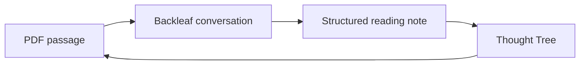

<div align="center">

# Backleaf 叶间

**Let every highlighted passage grow into a line of thought.**

Discuss PDF selections with AI, keep the useful parts as ordinary Markdown, and return to the source whenever you need.

[**English**](README.md) · [简体中文](README.zh-CN.md) · [日本語](README.ja.md) · [한국어](README.ko.md)

[](https://github.com/zefei124/backleaf/releases/latest)

[](LICENSE)


[**Download the latest release**](https://github.com/zefei124/backleaf/releases/latest) · [Installation](#installation) · [Privacy](docs/privacy.md) · [Changelog](CHANGELOG.md)

</div>

---

Backleaf keeps close reading inside Obsidian. Select a passage in a PDF, ask what you really want to understand, continue the conversation, and save the conclusion into a structured reading note. The note stays yours: it is plain Markdown, editable outside Backleaf, with a link back to the original passage.

## From a passage to a thought tree

| 1. Select | 2. Ask | 3. Keep | 4. Revisit |
|:--:|:--:|:--:|:--:|
| Highlight a PDF passage | Continue a focused conversation | Save the quote, dialogue, and your understanding | Review it in history or the Thought Tree |



## What feels different

- **The source stays in view.** Backleaf carries the selected text, book, chapter, page, and source link into the discussion.
- **Conversations become notes.** Useful discussions can be saved per book instead of disappearing in a chat log.
- **Your understanding remains yours.** You can write it yourself, edit an AI draft, and reopen saved discussions without losing the live conversation.
- **Backleaf respects external edits.** If a saved discussion changed outside the plugin, Backleaf refuses to overwrite it until you review the conflict.

## Installation

1. Download `main.js`, `manifest.json`, and `styles.css` from the [latest release](https://github.com/zefei124/backleaf/releases/latest).
2. Create `<vault>/.obsidian/plugins/backleaf/`.
3. Copy the three files into that folder.
4. Reload Obsidian and enable **Backleaf** under **Settings → Community plugins**.

> [!NOTE]
> Backleaf requires Obsidian 1.11.4 or later. It is not yet listed in the Obsidian Community directory.

## Set up your AI provider

Open **Settings → Community plugins → Backleaf**, then add your DeepSeek API key. The key is stored through Obsidian SecretStorage and is never written to Backleaf's `data.json`.

The default endpoint is `https://api.deepseek.com`. Advanced settings accept another compatible HTTPS endpoint or a local HTTP endpoint. Backleaf uses your own account and API quota.

## A private reading workflow

> [!IMPORTANT]
> Backleaf makes a network request only when you send a message. It sends the selected passage, book title, chapter when available, and the current Backleaf conversation to the endpoint you configured.

It does not intentionally send the whole PDF, unrelated vault notes, saved reading notes, local file paths, or other local data. Backleaf contains no client-side telemetry, advertising, or self-update mechanism. See the full [privacy documentation](docs/privacy.md).

## Contact

Questions, ideas, and feedback are welcome.

- Email: [hnyu588@gmail.com](mailto:hnyu588@gmail.com)
- WeChat: please include **Backleaf** in your friend request

<details>
<summary>Show the WeChat QR code</summary>

<br>


The QR code will appear after `docs/assets/contact-wechat.png` is uploaded.

</details>

## For contributors

```bash
npm install
npm run build
npm test
```

The release files are generated at the repository root: `main.js`, `manifest.json`, and `styles.css`. Backleaf is released under the [MIT License](LICENSE).
