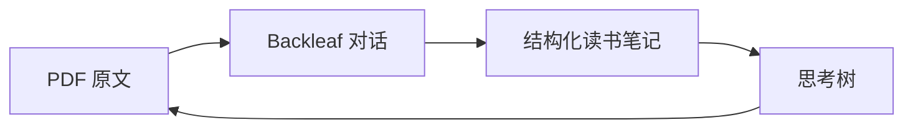

<div align="center">

# Backleaf 叶间

**让每一次划线，都继续长成思考。**

在 Obsidian 里围绕 PDF 原文追问，把真正有用的对话留下来，并随时回到原文。

[English](README.md) · [**简体中文**](README.zh-CN.md) · [日本語](README.ja.md) · [한국어](README.ko.md)

[](https://github.com/zefei124/backleaf/releases/latest)

[](LICENSE)


[**下载最新版**](https://github.com/zefei124/backleaf/releases/latest) · [安装方法](#安装) · [隐私说明](docs/privacy.zh-CN.md) · [更新日志](CHANGELOG.md)

</div>

---

Backleaf 让深度阅读留在 Obsidian 中。选中一段 PDF 原文，提出你真正关心的问题，继续追问，再把结论保存成结构化读书笔记。笔记始终是普通 Markdown：可以自由编辑，也保留了返回原文的链接。

## 从一段原文，长成一棵思考树

| 1. 选中 | 2. 追问 | 3. 留下 | 4. 回看 |
|:--:|:--:|:--:|:--:|
| 选中 PDF 原文 | 围绕原文继续讨论 | 保存引用、对话和你的理解 | 在历史讨论或思考树里重新展开 |



## 使用演示

> 🎬 Backleaf 使用视频正在准备中。

<!-- 视频准备好后，用下面两行替换上方提示：
[](VIDEO_URL)
-->

## 它有什么不同

- **原文一直在场。** 选区、书名、章节、页码和原文链接会随讨论一起保留。
- **对话不再只是聊天记录。** 有价值的讨论可以按书保存，逐渐沉淀成自己的读书笔记。
- **理解由你确认。** 你可以自己写，也可以修改 AI 草稿；查看历史后，当前讨论仍然可以恢复。
- **不会悄悄覆盖笔记。** 如果某条讨论在 Backleaf 外被修改，插件会先提示冲突，等你核对。

## 安装

1. 从[最新版本](https://github.com/zefei124/backleaf/releases/latest)下载 `main.js`、`manifest.json` 和 `styles.css`。
2. 创建 `<你的仓库>/.obsidian/plugins/backleaf/` 文件夹。
3. 把三个文件复制进去。
4. 重新加载 Obsidian，然后在 **设置 → 第三方插件** 中启用 **Backleaf**。

> [!NOTE]
> Backleaf 需要 Obsidian 1.11.4 或更高版本，目前尚未上架 Obsidian 社区插件目录。

## 配置 AI 服务

打开 **设置 → 第三方插件 → Backleaf**，填入 DeepSeek API Key。密钥通过 Obsidian SecretStorage 保存，不会写入 Backleaf 的 `data.json`。

默认接口地址是 `https://api.deepseek.com`。高级设置也支持其他兼容的 HTTPS 接口和本机 HTTP 接口。API 费用由你自己的服务商账户承担。

## 隐私边界

> [!IMPORTANT]
> 只有在你发送消息时，Backleaf 才会向设置中的 AI 接口发起请求。发送内容包括当前选区原文、书名、可用时的章节，以及当前 Backleaf 对话。

Backleaf 不会主动发送整本 PDF、无关的仓库笔记、已保存的读书笔记、本地文件路径或其他本地数据，也不包含客户端遥测、广告或自行更新机制。详见[隐私说明](docs/privacy.zh-CN.md)。

## 联系作者

欢迎告诉我你遇到的问题、想要的功能，或者实际使用感受。

- 邮箱：[hnyu588@gmail.com](mailto:hnyu588@gmail.com)
- 微信：添加时请备注 **Backleaf**

<details>
<summary>查看微信二维码</summary>

<br>


上传 `docs/assets/contact-wechat.png` 后，二维码会显示在这里。

</details>

## 参与开发

```bash
npm install
npm run build
npm test
```

发布文件生成在仓库根目录：`main.js`、`manifest.json` 和 `styles.css`。Backleaf 使用 [MIT License](LICENSE)。
